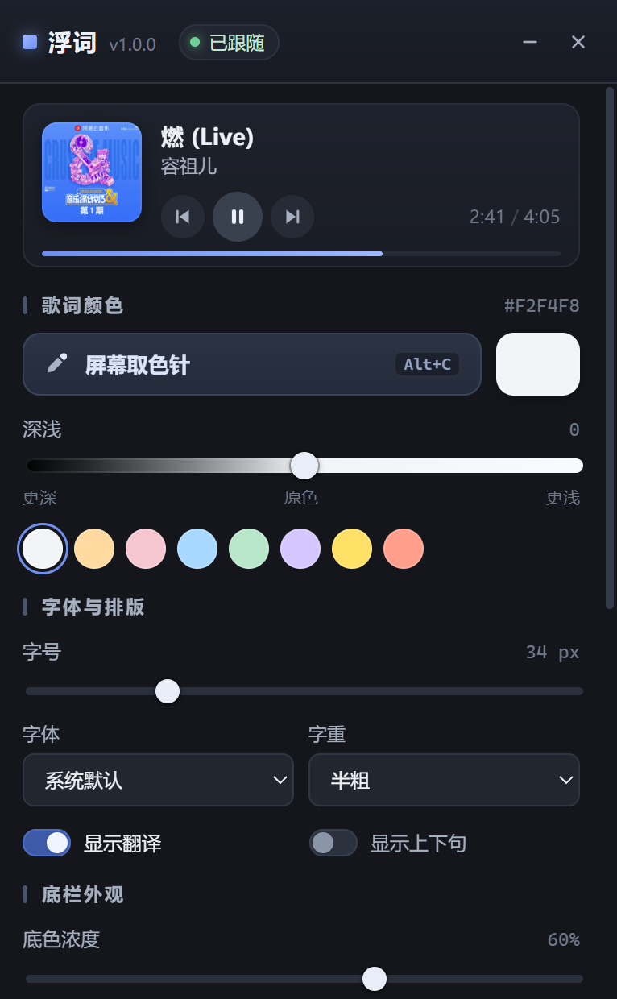
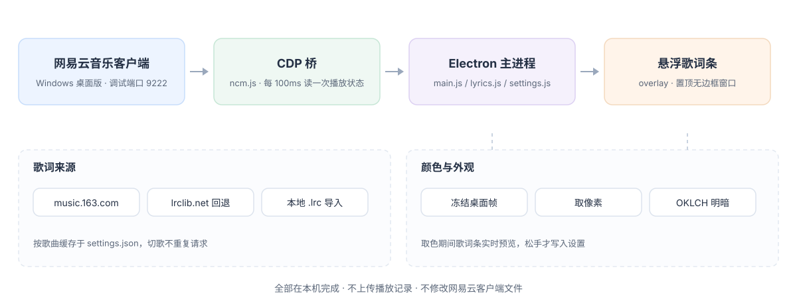

<div align="center">


**A Windows desktop lyrics overlay that follows NetEase Cloud Music. By default it is one bare line of text, sitting quietly on your working screen.**

[](LICENSE)
[](#known-limitations)
[](package.json)
[](#how-it-works)
[](https://github.com/YardonYan/FloatLyric/releases/latest)
[](#disclaimer)

[中文](README.md) · **English**

</div>

---

> You want to see the lyrics while working, but switching NetEase Cloud Music to the foreground is a bit loud. So let the current line stay on screen, looking much like the text around it.

FloatLyric is a Windows desktop lyrics overlay. It follows playback in the NetEase Cloud Music desktop client and shows the current line, with an optional translation. The default appearance is a single bare line of text: no background, no glow, no progress bar — it reads like one extra sentence someone left in a document.

The line is left-aligned, so a longer lyric grows to the right instead of covering the content on the left, and the transparent parts of the window are click-through. When you want it clearer, colour, lightness, font size, font weight, background density and glow are all continuously adjustable from the panel; the whole strip can be dragged anywhere, locked in place, or made fully click-through.

Plain Electron plus vanilla JavaScript. No native modules, zero third-party runtime dependencies.

## What This Is

Desktop lyrics tools are usually an obvious floating window: background, album art, playback controls — unmistakably a music app. FloatLyric goes the other way and reduces the lyrics to the lowest possible profile: one 22px line in regular weight, dark ink grey `#3D434B`, background density and glow both at 0, progress bar off, window 620 × 84 (resizable from the bottom-right grip).

To blend in further, use the screen eyedropper to sample the body text colour of the window you are working in; the lyric line takes on the same ink. To make it stand out, raise the background density or glow sliders — a soft backing plate and a light halo come back. Both sliders scale continuously from 0, and 0 means genuinely off, not "the lowest visible setting".

## Screenshots

<p align="center">
  
</p>

<p align="center">
  
</p>

Both are real runtime screenshots: the first shows the strip with its background and progress bar enabled, the second shows the control panel.

## Features

| Capability | Detail |
| --- | --- |
| Playback sync | Reads client playback state every 100 ms while playing (slower when paused); switches lyrics on song change, and probes/reconnects on its own if NetEase starts later |
| Lyrics and translation | NetEase lyrics endpoint first, lrclib.net as fallback; translation line scales with the main line; honours LRC `[offset:]` and detects instrumental placeholders |
| Local lyrics | Import `.lrc` / `.txt` from the panel to replace the current lyrics immediately |
| Screen eyedropper | Freezes the desktop on invocation, live preview as the pointer moves, left click to pick, right click or `Esc` to cancel |
| Colour lightness | Adjusts perceptual lightness in OKLCH; negative is deeper, positive is lighter |
| Typography | Left-aligned by default, so a long line grows to the right instead of over the left side; font size, weight, installed system font, context lines and translation toggle; lines that still overflow at the minimum size scroll horizontally |
| Strip appearance | Background density, glow, and progress bar toggle |
| Window behaviour | Drag the lyric text to move, transparent areas are click-through, either vertical edge resizes the width, bottom-right grip resizes both dimensions, lock position, one-key show / hide, the close button can send the panel to the tray or quit, configurable shortcuts |
| Extras | Launch at login, tray menu, playback buttons, settings and lyric cache (keyed by title/artist/duration, capped at 80 songs) |

## Quick Start

Grab the portable exe from [Releases](https://github.com/YardonYan/FloatLyric/releases/latest) and double-click it — no installation. Confirm three things first, or nothing will work:

| Prerequisite | Detail |
| --- | --- |
| Windows 10 / 11 | The main process uses PowerShell, registry lookups, the Windows task list and Windows screen capture |
| NetEase Cloud Music desktop client | The web player, mobile apps and other clients are out of scope |
| Debugging port available | The client needs to be started with `--remote-debugging-port=9222`; one click in the panel handles the first time, see "Connecting to NetEase Cloud Music" below |

On first launch nothing in the NetEase installation is modified; the app only tries to reach port 9222 on localhost. To run from source or package it yourself, see options 2 and 3 below.

## Ways to Use

Pick whichever of the three fits.

### Option 1: Portable exe

For users who do not want Node.js installed. Download `FloatLyric-1.1.1-portable.exe` from [Releases](https://github.com/YardonYan/FloatLyric/releases/latest), put it somewhere that will not be moved around, and double-click. Settings live in `%APPDATA%\浮词\settings.json` and do not depend on where the exe sits. A build produced locally with `npm run dist` uses the same name.

One caveat: enabling launch at login registers the current exe path. If you later move the exe, toggle the switch off and back on in the panel so the registered path is refreshed.

### Option 2: Run from source

For reading the implementation or making a quick change. Requires Node.js (20 or newer recommended) and npm:

```powershell
git clone https://github.com/YardonYan/FloatLyric.git
cd FloatLyric
npm install
npm start
npm test      # unit tests
npm run lint  # lint
```

`npm run dev` starts development mode. Only in this mode are the development-only full-screen capture handlers registered; they are absent from packaged builds.

### Option 3: Build it yourself

For changing the version, icon or artifact name:

```powershell
npm run dist
```

Output goes to `dist/` as a single-file portable build by electron-builder. Build artifacts are not committed to this repository; publish them through your own Release if you need to distribute them.

### When it is not a fit

- macOS and Linux: the implementation depends on Windows-specific interfaces and has not been ported.
- The NetEase web player, mobile clients, car clients, or other players such as Spotify and QQ Music.
- Karaoke-style word-by-word filling or millisecond-accurate sync. Position is derived from the pixel ratio of the progress bar, accurate to roughly 0.1 seconds.
- Managed environments that forbid launching the client with debugging flags. Check your local policy first.

## Connecting to NetEase Cloud Music

FloatLyric reads playback state and track information through the debugging port that the NetEase client itself exposes. By default it listens on `127.0.0.1:9222`, reachable only from the local machine. The implementation does not inject into the process, install hooks, or modify any file in the client's installation directory.

CDP (Chrome DevTools Protocol) is the debugging interface exposed by Chromium. The NetEase desktop client is Chromium-based, so once the debugging port is enabled it exposes a local endpoint from which FloatLyric reads progress, title, artist and duration.

On first use, one of three things happens:

| Panel state | What to do |
| --- | --- |
| NetEase is not running | Just start it; FloatLyric probes and reconnects automatically |
| NetEase is running without the debugging port | A hint appears at the top of the panel; click "Launch NetEase with debugging", or use the same entry in the tray menu |
| The port is open but the connection dropped | Click "Reconnect" in the panel; the same entry is in the tray menu |

Clicking "Launch NetEase with debugging" force-terminates a running `cloudmusic.exe`, then starts it again with `--remote-debugging-port=9222`. The playlist is usually preserved and the current song restarts from the beginning. Save anything pending in the client before clicking. After that, launching NetEase normally is enough — FloatLyric probes and reconnects on its own.

The port can be changed through the `cdpPort` field in the settings file; if the client was started on a different port, keep the two values in sync.

## Controls & Shortcuts

| Action | How |
| --- | --- |
| Move the strip | Drag the lyric text itself; the transparent rest of the window is click-through and never covers the app below |
| Resize | Drag either vertical edge of the strip to change width, or the bottom-right grip to change width and height |
| Lock / unlock | Lock icon in the strip's hover toolbar, or `Alt+Shift+L`; a locked strip stays put and the whole window becomes pass-through |
| Click-through | Panel toggle; when on, even the lyrics stop intercepting the mouse (fully pass-through) |
| Screen eyedropper | "Screen eyedropper" in the panel, or `Alt+C` |
| Show / hide the strip | `Alt+L` |
| Open the panel | `Alt+P`, or the tray icon |
| Import local lyrics | "Import .lrc" in the panel; pick a `.lrc` / `.txt` file |
| Re-fetch lyrics | The button of the same name in the panel forces a refresh for the current song |
| Close the panel | The X button; choose "send to tray" (default) or "quit" under Window in the panel |
| Reopen the panel | Desktop shortcut, click the tray icon, or `Alt+P` |
| Launch at login | Panel toggle |
| Playback control | Previous, pause / play and next buttons in the panel |

While picking, the strip previews the colour under the pointer live; only a left click writes it to settings. Right click or `Esc` cancels and restores the previous colour. The desktop returns to live rendering once picking ends.

## How It Works



In the main process, `ncm.js` opens a CDP WebSocket to the client page and evaluates the reader expression in `extract.js` every 100 ms while playing (400 ms while paused), returning title, artist, duration and progress. A song change triggers a lyric lookup: `lyrics.js` queries the NetEase lyrics endpoint (including the translation) first and falls back to lrclib.net; results are cached per song in the settings file so switching back does not repeat the request. The UI side is three separate frameless Electron windows — the strip, the panel and the picker overlay — talking to the main process over IPC channels exposed by the preload script.

Colour picking is a separate path. A fullscreen topmost picker makes some Chromium windows count as occluded; they stop presenting frames, and a live capture reads black in that region. So the implementation grabs one desktop frame with Electron's `desktopCapturer` before the picker exists and samples that frozen frame throughout. Pointer coordinates are mapped onto the frame's pixel grid using the display scale factor, and the loupe shows a real pixel neighbourhood rather than a flat swatch. `renderer/shared/color.js` adjusts lightness in OKLCH, a colour space with a perceptual lightness axis, which avoids the hue shifts that come from editing RGB brightness directly.

## Settings & Lyrics

- Settings are stored in `%APPDATA%\浮词\settings.json`: strip position, colour, font size, window behaviour and the lyric cache, restored on restart. The repository `.gitignore` excludes this file — do not commit personal settings.
- Lyrics come from public endpoints first, then lrclib.net; if neither has a match, import a local `.lrc` / `.txt`.
- The cache key is title, artist and duration, so a live version cannot reuse the studio timeline; the cache keeps the 80 most recent songs. "Re-fetch lyrics" in the panel bypasses it.
- The font dropdown lists fonts installed on the current machine, so its options vary by system. No font files are shipped.

## Project Layout

```
electron/      Main process: windows and tray, shortcuts, CDP bridge, picker, lyrics, settings
renderer/      Three UIs: overlay strip / panel / picker
renderer/shared/  Colour conversion, font enumeration, design tokens
assets/        Icons and README illustrations
build/         Build icon
scripts/       Dev tools: CDP queries, input injection, system mouse and capture, icon generation
preview/       Static design draft of the strip
research/      Early feasibility probes (SMTC probe, CDP extraction), not used at runtime
tools/         Illustration generator for the README
tests/         Unit tests on Node's built-in test runner (lyrics parsing, colour math)
.github/       GitHub Actions: tests, lint and packaging check
eslint.config.js  ESLint configuration
```

`assets/hero.svg` and `assets/architecture.svg` are generated by `python tools/gen_readme_images.py` with no dependencies. To change an illustration, edit the script and regenerate — do not hand-edit the SVGs.

The CI workflow lives at `.github/workflows/ci.yml` and runs on every push to `main` and on pull requests: the `check` job runs `npm ci`, `npm test` and `npm run lint`; the `build` job runs `npm run dist:dir` and uploads `dist/win-unpacked` as an artifact for 7 days (no portable self-extractor, to keep every push cheap).

## Known Limitations

- Picking uses "freeze on invocation": the picker shows the frame captured at the moment it opened, so video stays on that frame. This avoids the black regions caused by Chromium windows stopping presentation when occluded. The desktop becomes live again after cancelling or committing.
- Playback position is derived from the pixel ratio of the progress bar, accurate to roughly 0.1 seconds. There is no karaoke-style word-by-word filling.
- Playback state and the control buttons depend on accessibility labels inside the client page (for example `播放进度调节`, `pause` / `play` / `pre` / `next` / `lyric`). A client redesign can break reading or control, in which case the selectors in `electron/extract.js` and `electron/ncm.js` need updating.
- Restarting the client in debugging mode force-terminates its process and the current song starts over.
- Coverage is currently limited to Windows 10 / 11 and the NetEase Cloud Music desktop client.

## Troubleshooting

Each row below maps to a branch or hint that actually exists in the code. Work through them in order.

| Symptom | Cause and fix |
| --- | --- |
| Panel shows disconnected while NetEase is open | FloatLyric probes port 9222 every 2 seconds, so give it a moment; if the client was started on another port, set `cdpPort` to match, or click "Launch NetEase with debugging" |
| Still disconnected after launching in debugging mode | The probe waits up to about 20 seconds. If security software blocks the client or it starts slowly, wait until it is fully up and click "Reconnect" |
| The NetEase executable cannot be found | Common install directories and the `DisplayIcon` value of uninstall registry entries are checked in order. For an unusual location, start the client with the debugging port yourself — FloatLyric will connect to the existing port |
| Connected, but lyrics stay empty | Use "Re-fetch lyrics" to bypass the cache; if still empty, import a local `.lrc` / `.txt` |
| Lyrics drift out of sync | Fine-tune the offset in the panel; when importing local lyrics, check that the file's timeline matches the version being played |
| Video freezes while picking | By design — the frozen frame from the moment of invocation is what gets sampled. It resumes after cancelling or committing |
| A region of the picker looks black | The frozen frame was captured at invocation; if video was playing there, invoke the eyedropper again |
| Launch at login stops working after moving the portable exe | The old path is registered; toggle the switch off and back on in the panel |
| Source edits do not show up in the panel | Main-process changes need an app restart; for `renderer/`-only changes, close and reopen the panel |

## Disclaimer

This is a personal open-source project, written to learn about Windows desktop windows, the Chromium debugging protocol and the basics of an Electron app. **It must not be used commercially.**

- It is not affiliated with, authorised by, or endorsed by NetEase Cloud Music or its operator. "NetEase Cloud Music" in the project name only identifies the client it talks to; it implies no partnership or endorsement.
- Songs, lyrics, album metadata and related content are the property of NetEase Cloud Music and their respective rights holders. The project does not provide, download, store or distribute any audio, lyric or font file; it only reads the playback state and lyric text already displayed in the client's own interface on the local machine.
- The project does not inject into client processes, install hooks, or modify any file in the client's installation directory. Whether launching the client with debugging flags is permitted, and any account, service or compliance risk that follows, is for the user to judge and bear.
- The author accepts no liability for any direct or indirect loss arising from the use of, or inability to use, this project.
- The repository is licensed under Apache-2.0, which covers this project's code and documentation only. It does not imply the same freedom for third-party services, clients or lyric content.
- If a rights holder considers any behaviour inappropriate, open an issue in this repository; the maintainer will review and adjust.

## License

Licensed under the **Apache License 2.0**. Full text in [LICENSE](LICENSE), copyright line `Copyright 2026 YardonYan`.

Apache-2.0 from the first public release. During development `package.json` said MIT; that was unified before publishing, so no previously distributed copy is affected.
