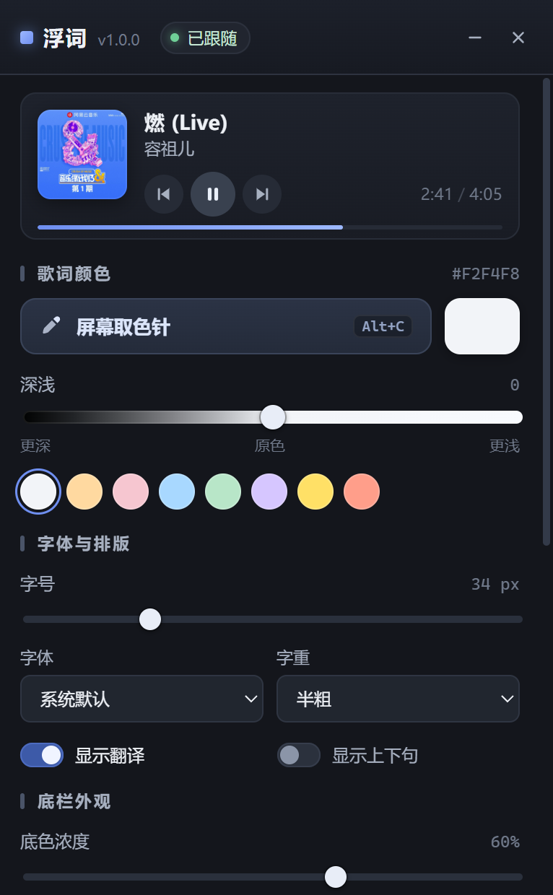
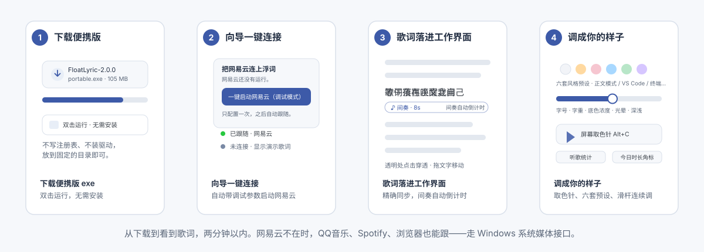
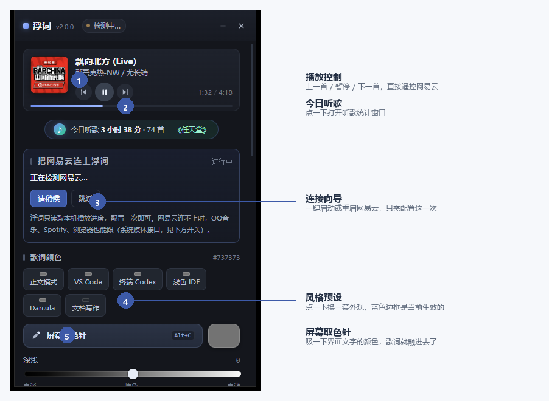
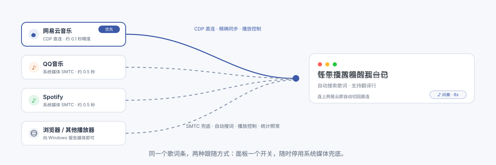
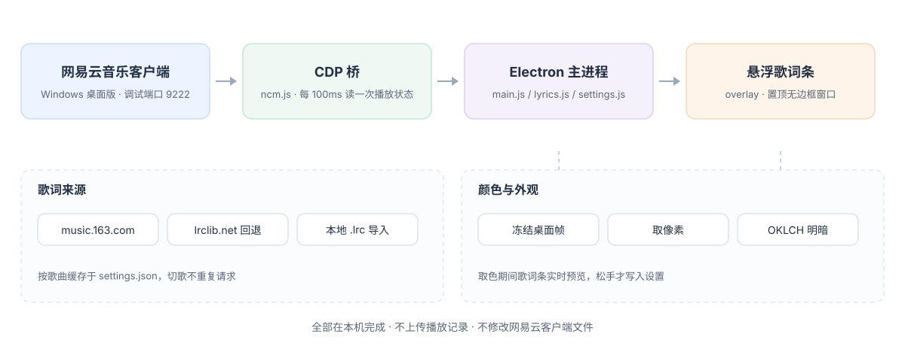

<div align="center">


**Windows 上的桌面悬浮歌词：跟网易云，也跟 QQ 音乐、Spotify、浏览器——任意播放器。默认只有一行裸文字，安静地落在工作界面里。**

[**在线介绍站 ↗**](https://floatlyric-x7alhjqexlp.qoder.zone) — 滚动叙事 + 可交互歌词演示，无需安装即可体验外观调节

[](LICENSE)
[](#已知限制)
[](package.json)
[](#工作方式)
[](https://github.com/YardonYan/FloatLyric/releases/latest)
[](#免责声明)

**中文** · [English](README.en.md)

</div>

---

# 浮词 FloatLyric — 跟随网易云音乐的桌面歌词（开源 · 免安装 · 摸鱼友好）

> 工作时想看歌词，但把网易云切到前台太张扬。不如让当前这一句，以和正文差不多的样子，留在屏幕上。

浮词是一个 Windows 桌面悬浮歌词条：跟随网易云音乐客户端的播放进度，显示当前歌词与可选翻译。网易云没开调试端口时，它还能通过 Windows 系统媒体接口跟随任意播放器——QQ音乐、Spotify、浏览器都行。默认只有一行裸文字，没有底色、没有光晕、没有进度条，看起来像文档里随手多出来的一句话——为上班摸鱼听歌而生。

歌词左对齐，长句向右展开，不压住左边正在看的内容；透明处点击穿透，拖文字即挪位置。颜色、字号、底色与光晕连续可调，也能一键套用风格预设。纯 Electron 加原生 JavaScript，运行时零第三方依赖。

**目录** · [快速开始](#快速开始) · [功能一览](#功能一览) · [介绍站](#在线介绍站) · [使用途径](#使用途径) · [连接网易云](#第一次连接网易云) · [跟随其他播放器](#跟随其他播放器系统媒体兜底) · [快捷键](#操作与快捷键) · [进阶](#工作方式) · [已知限制](#已知限制) · [排错](#排错) · [免责声明](#免责声明)

## 在线介绍站

**<https://floatlyric-x7alhjqexlp.qoder.zone>**

一个滚动叙事的介绍站，把浮词的设计思路讲清楚：从「把存在感压到最低」到点击穿透、取色 / 调节 / 统计三件事、六套风格预设。站内有一块可交互的歌词演示面板——字号、字重、底色浓度、光晕、颜色深浅（OKLCH）、等宽字体、翻译行、进度条、锁定穿透都能实时调，还能一键切换六套预设、复制当前外观 JSON。不用安装 exe 就能先看到歌词条落在工作界面里的样子。

## 效果预览

<p align="center">
  
</p>

这就是跟随时真实的样子：默认一行 22px 常规字重的深灰墨色 `#3D434B`，无底色无光晕，窗口 620 × 84（可拖右下角手柄缩小）。歌词逐句切换，间奏自动倒计时，透明处不挡鼠标。

<p align="center">
  
</p>

<p align="center">
  
</p>

上面两张是实际运行截图：第一张为开启底色与进度条后的歌词条，第二张为控制面板。

## 功能一览

| 能力 | 说明 |
| --- | --- |
| 跟随播放进度 | 优先直连网易云（每 100 毫秒读取，暂停自动降频）；没连上时走系统媒体接口跟任意播放器，连上即自动切回 |
| 歌词与翻译 | 网易云接口优先、lrclib.net 兜底，自动搜索、翻译行、纯音乐占位、手动换源与 `.lrc` 导入 |
| 外观 | 取色针吸色融入界面、OKLCH 深浅、六套风格预设、字号字重、底色浓度与光晕，全部连续可调 |
| 窗口行为 | 拖文字移动、透明处穿透、边缘调宽、锁定、托盘收起、多屏插拔自动拉回 |
| 贴心细节 | 首启向导一键连接、未连接时演示模式、间奏自动倒计时 |
| 听歌统计 | 今日/周/月时长与首数、时段分布、TOP 榜、Markdown/CSV 导出，仅存本地 |
| 其他 | 开机自启、快捷键自定义、歌词缓存 80 首、可选诊断日志 |

## 快速开始

<p align="center">
  
</p>

到 [Releases](https://github.com/YardonYan/FloatLyric/releases/latest) 下载便携版 exe，双击运行，无需安装。用之前确认三件事，缺一条跑不起来：

| 前提 | 说明 |
| --- | --- |
| Windows 10 / 11 | 主进程用到了 PowerShell、注册表查询、系统任务列表与 Windows 屏幕捕获 |
| 桌面版网易云音乐客户端 | 网页版、手机版不在支持范围内；不开调试端口时也可通过系统媒体接口跟随其他播放器 |
| 调试端口可用（可选） | 客户端以 `--remote-debugging-port=9222` 启动时跟随最精确；面板向导一键完成配置，详见下文「第一次连接网易云」 |

首次启动不会改动网易云的任何文件，只会尝试连接本机的 9222 端口。想从源码运行或自行打包，见下一节的途径二、途径三。

装好之后，认识面板里这五个地方就够了：

<p align="center">
  
</p>

## 使用途径

按用途分三种，选一种即可。

### 途径一：便携版 exe

适合只想用、不想装 Node.js 的情况。从 [Releases](https://github.com/YardonYan/FloatLyric/releases/latest) 下载 `FloatLyric-2.0.0-portable.exe`，放到一个不会被频繁移动的目录，双击运行。设置写在 `%APPDATA%\浮词\settings.json`，与 exe 所在位置无关。自行用 `npm run dist` 构建时，产物名同样是 `FloatLyric-2.0.0-portable.exe`。

需要注意：开启开机自启时会登记当前 exe 的路径；之后如果把 exe 移到别处，请在面板里关掉再开一次开关，让登记的路径更新。

### 途径二：源码运行

适合想看实现或临时改动。需要 Node.js（建议 20 或更高）与 npm：

```powershell
git clone https://github.com/YardonYan/FloatLyric.git
cd FloatLyric
npm install
npm start
npm test      # 单元测试
npm run lint  # 代码检查
```

开发模式用 `npm run dev`，仅在此模式下会注册开发期专用的全屏截图接口，打包产物中不存在这些接口。

### 途径三：自行打包

适合想改版本号、图标或产物名的场景：

```powershell
npm run dist
```

产物落在 `dist/`，由 electron-builder 生成单文件便携版。仓库不纳入构建产物，需要分发时建议放到自己的 Release。

### 不适用场景

- macOS 与 Linux：实现里依赖 Windows 专有接口，暂未适配。
- 网易云网页版、移动端、车机端。桌面版网易云不向 Windows 报告媒体，必须开启调试端口才能跟随；QQ音乐、Spotify、浏览器等已可通过系统媒体接口跟随。
- 需要逐字卡拉 OK 式填充、或毫秒级精确同步的用法；进度来自播放进度条的像素比例换算，精度约 0.1 秒级（系统媒体兜底约 0.5 秒级）。
- 统一管控、不允许以调试参数启动客户端的办公环境。请先确认本机策略再使用。

## 第一次连接网易云

浮词通过网易云客户端自带的调试端口读取播放状态与歌曲信息。这个端口默认监听 `127.0.0.1:9222`，只在本机可访问；实现上不注入进程、不挂钩子、不修改客户端安装目录里的任何文件。

CDP（Chrome DevTools Protocol）是 Chromium 内核对外提供的调试协议；网易云桌面客户端基于 Chromium，开启调试端口后会暴露一个本机调试入口，浮词从这里读取播放进度、歌曲名、歌手与时长。

首次使用会遇到三种情况：

| 面板状态 | 处理方式 |
| --- | --- |
| 网易云尚未运行 | 直接启动网易云，浮词会自动探测并重连；也可在面板向导里点「一键启动网易云（调试模式）」 |
| 网易云在运行、但没有开启调试端口 | 面板向导点「一键重启网易云并开启调试」，或点托盘菜单里的「以调试模式启动网易云」 |
| 调试端口被其他程序占用 | 关闭占用 9222 端口的程序后点「重新检测」；占用者退出后浮词也会自动恢复 |
| 已开启调试端口、但暂时连不上 | 面板点「重新检测」，托盘菜单里也有同一入口 |

点「以调试模式启动网易云」时，程序会先强制结束正在运行的 `cloudmusic.exe`，再带 `--remote-debugging-port=9222` 重新启动它。播放列表通常保留，当前歌曲会从头开始。请先保存客户端里未提交的操作再点。之后每次正常双击网易云图标启动即可，浮词会自动探测并重连。

调试端口可在设置文件的 `cdpPort` 字段调整；若客户端已用别的端口启动，两边保持一致即可。

## 跟随其他播放器（系统媒体兜底）

<p align="center">
  
</p>

网易云没连上时，浮词会改从 Windows 系统媒体接口（SMTC）读取当前播放：任何向 Windows 报告媒体的播放器——QQ音乐、Spotify、Apple Music、浏览器、PotPlayer 等——都能驱动歌词条，浮词自动按歌名/歌手搜索歌词，播放控制与听歌统计照常工作。网易云连上后自动切回直连，进度更精确。

两点限制：系统媒体模式的进度来自系统时间线推算，精度约 0.5 秒级；网易云桌面版自身不向 Windows 报告媒体，因此想跟网易云还是要开启调试端口（面板向导一键完成）。面板「跟随其他播放器（系统媒体）」开关默认开启，不想让浮词读其他播放器时可以关掉。

## 操作与快捷键

| 动作 | 方式 |
| --- | --- |
| 移动歌词条 | 按住歌词文字拖动；窗口透明区域默认穿透，不会挡住下层窗口 |
| 调整大小 | 拖窗口左右边缘调宽度，拖右下角手柄同时调宽高 |
| 锁定 / 解锁 | 歌词条悬停工具栏的锁图标，或 `Alt+Shift+L`；锁定后位置固定、窗口完全穿透 |
| 鼠标穿透 | 面板开关；开启后连歌词也不拦截鼠标（完全穿透） |
| 屏幕取色针 | 面板「屏幕取色针」或 `Alt+C` |
| 显示 / 隐藏歌词条 | `Alt+L` |
| 打开面板 | `Alt+P` 或托盘图标 |
| 导入本地歌词 | 面板「导入 .lrc」，选 `.lrc` / `.txt` 文件 |
| 重新搜索歌词 | 面板同名按钮，强制刷新当前歌曲的歌词 |
| 关闭面板 | 右上角 X；在面板「窗口」里可选收起到托盘（默认）或直接退出 |
| 重新打开面板 | 桌面快捷方式、单击托盘图标，或 `Alt+P` |
| 手动换源歌词 | 面板「手动搜索」：输入歌名/歌手列出候选，点「使用」直接换词 |
| 查看听歌统计 | 面板「听歌统计」按钮、托盘菜单同名项 |
| 开机自启 | 面板开关 |
| 播放控制 | 面板上的上一首、暂停 / 播放、下一首按钮 |

取色期间，歌词条会实时预览指针当前指向的颜色，左键确认才写入设置；右键或 `Esc` 取消则恢复原色。取消取色后桌面恢复实时显示。

## 工作方式



主进程里的 `ncm.js` 通过 CDP 的 WebSocket 连到客户端页面，播放中每 100 毫秒、暂停时每 400 毫秒执行一次 `extract.js` 里的读取表达式，拿到歌曲名、歌手、时长与进度。歌曲变化时触发歌词获取：`lyrics.js` 先查网易云歌词接口（含翻译），匹配不到时回退 lrclib.net，结果按歌曲缓存在设置文件里，切歌不会重复请求。界面侧是三个独立的无边框 Electron 窗口，分别负责歌词条、控制面板和取色罩，通过预加载脚本暴露的 IPC 通道与主进程通信。

取色是一条单独的链路。全屏置顶的取色罩会让部分 Chromium 窗口判定为被遮挡而停止出帧，此时实时抓屏会在那片区域读到黑色。因此实现改为在唤起取色罩之前，先用 Electron 的 `desktopCapturer` 抓一帧桌面并冻结，取色全程采样这一帧；指针坐标按显示器的缩放比例映射到该帧的像素网格，放大镜显示的是真实像素邻域。`renderer/shared/color.js` 用 OKLCH（一种以感知亮度为轴的色彩空间）做明度调整，比直接改 RGB 亮度更不容易出现色相偏移。

## 设置与歌词

- 设置保存在 `%APPDATA%\浮词\settings.json`，包含歌词条位置、颜色、字号、窗口行为与歌词缓存，重启后恢复。仓库里的 `.gitignore` 已排除该文件，请勿把个人设置提交进来。
- 歌词优先走公开接口，匹配不到时回退 lrclib.net；两者都取不到时，可导入本地 `.lrc` / `.txt`。
- 歌词按「歌名 + 歌手 + 时长」缓存，最多保留 80 首，同名不同版本不会串时间轴；面板「重新搜索歌词」可绕过缓存强制刷新。
- 字体下拉列出的是本机已安装字体，选项随系统环境变化，不随项目分发字体文件。

## 项目结构

```
electron/    主进程：窗口与托盘、快捷键、CDP 桥、取色、歌词、设置与听歌统计
electron/stats.js  听歌统计：计时结算、NDJSON 落盘、聚合与报告
renderer/    四个界面：overlay 歌词条 / panel 面板 / picker 取色罩 / stats 听歌统计
renderer/shared/  颜色换算、字体枚举与设计变量
assets/      图标与 README 配图
build/       打包用图标
scripts/     开发期工具：CDP 查询、输入注入、系统级鼠标与截屏、图标生成
preview/     歌词条静态设计稿
research/    前期方案验证（SMTC 探针、CDP 抓取脚本），不参与运行
tools/       开发期工具：README 配图生成、Release 发布脚本
tests/       Node 内置 test runner 的单元测试（歌词解析、配色计算、听歌统计）
.github/     GitHub Actions：测试、lint 与打包校验
eslint.config.js  ESLint 配置
```

`assets/hero.svg` 与 `assets/architecture.svg` 由 `python tools/gen_readme_images.py` 生成，零依赖；改图请改脚本后重新生成，不要直接编辑 SVG。

CI 工作流在 `.github/workflows/ci.yml`，推到 main 或发起 PR 即触发：`check` 跑 `npm ci`、`npm test`、`npm run lint`；`build` 跑 `npm run dist:dir` 并把 `dist/win-unpacked` 作为 artifact 存 7 天（不做 portable 自解压包，省每次推送的构建时间）。

发版走 `tools/release.py`：版本号取自 `package.json`，正文取自 `CHANGELOG.md` 里该版本的条目，产物大小与 SHA-256 自动算出，发布后回读校验。全程 UTF-8 并在提交前自检，避免中文在 Windows 命令行里被转成问号。先 `npm run dist` 出包，再：

```bash
GITHUB_TOKEN=ghp_xxx python tools/release.py --dry-run   # 只打印，不写
GITHUB_TOKEN=ghp_xxx python tools/release.py
```

## 已知限制

- 取色采用「唤起即冻结」：取色罩里看到的是唤起那一刻的画面，视频会停在那一帧。这是为了避开 Chromium 窗口被遮挡后停止出帧、导致实时抓屏读到黑色的问题。取消或完成取色后恢复实时桌面。
- 播放进度由进度条的像素比例换算，精度约 0.1 秒级；不做逐字卡拉 OK 式填充。
- 播放状态与控制按钮依赖客户端页面里的无障碍标签（例如 `播放进度调节`、`pause` / `play` / `pre` / `next` / `lyric`）。客户端改版可能让这部分读取或控制失效，需要同步更新 `electron/extract.js` 与 `electron/ncm.js` 里的选择器。
- 以调试模式重启客户端会强制结束其进程，当前歌曲从头开始。
- 目前只覆盖 Windows 10 / 11 与桌面版网易云音乐客户端。

## 排错

以下条目对应代码里确实存在的分支与提示，按顺序排查即可。

| 现象 | 原因与处理 |
| --- | --- |
| 面板显示未连接，但网易云已经开着 | 浮词每 2 秒自动探测一次 9222 端口，稍等即可；若客户端用其他端口启动，把设置里的 `cdpPort` 改成一致的值，或点「以调试模式启动网易云」 |
| 以调试模式启动后仍连不上 | 程序最多等待约 20 秒探测端口。期间若客户端被安全软件拦截或启动很慢，等客户端完全起来后点「重新连接」 |
| 找不到网易云安装路径 | 会依次查常见安装目录与卸载注册表项的 `DisplayIcon`；装在非常规目录时，可先手动以调试端口启动客户端，浮词会直接连现成的端口 |
| 已连接，但歌词一直为空 | 用面板「重新搜索歌词」绕过缓存；仍为空时导入本地 `.lrc` / `.txt` |
| 歌词与进度对不上 | 面板可微调偏移；导入本地歌词时，确认文件的时间轴与当前播放版本一致 |
| 取色时视频不动、画面停在某一帧 | 设计如此，采样的就是唤起瞬间冻结的那一帧；取消或取色完成后恢复 |
| 取色罩里某块窗口发黑 | 冻结帧取自唤起那一刻；若该区域当时正在播放视频，重新唤起取色针即可 |
| 移动过便携版 exe 后开机自启失效 | 登记的是旧路径，在面板里关掉再开一次开关 |
| 改了源码但面板没变化 | 主进程代码需重启应用；仅改 `renderer/` 下的界面代码，可关掉面板重新打开 |

## 免责声明

本项目是一个个人开源项目，用于学习和了解 Windows 桌面窗口、Chromium 调试协议与 Electron 应用的基本做法，**不得用于任何商业用途**。

- 与网易云音乐及其运营方没有任何关联，也未获得其授权或认可。项目名称中的"网易云"仅指明所对接的软件，不表示任何合作或背书关系。
- 歌曲、歌词、专辑信息及相关内容的著作权归网易云音乐及各自权利人所有。项目不提供、不下载、不存储、不分发任何音频、歌词或字体文件，只读取本机客户端界面上已经显示的播放状态与歌词文本。
- 项目不注入客户端进程、不挂钩子、不修改客户端安装目录中的任何文件；是否允许以调试参数启动客户端，以及由此产生的账号、服务或合规风险，由使用者自行判断并承担。
- 因使用或无法使用本项目造成的任何直接或间接损失，作者不承担责任。
- 仓库按 Apache-2.0 授权，该许可仅覆盖本项目的代码与文档，不代表第三方服务、客户端与歌词内容同样可以自由使用。
- 若权利方认为项目中的某些行为不妥，可在本仓库 Issues 中说明，维护者会评估并调整。

## 许可

本项目采用 **Apache License 2.0**，全文见 [LICENSE](LICENSE)，版权行 `Copyright 2026 YardonYan`。

首次公开发布时即采用 Apache-2.0。开发期 `package.json` 曾写作 MIT，开源前已统一，不涉及任何已分发副本。
